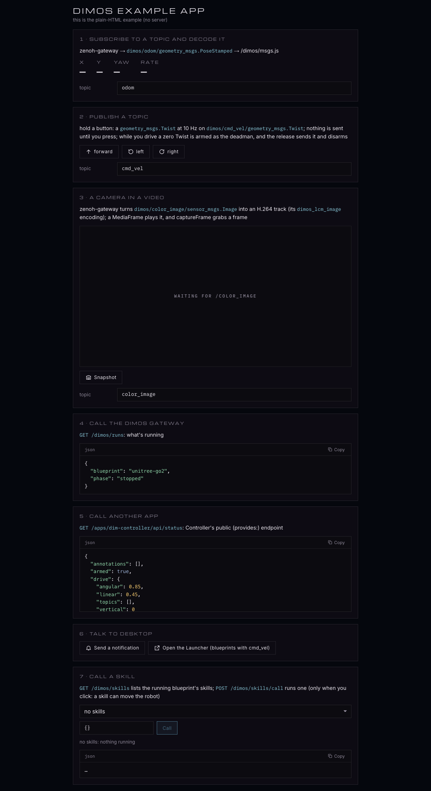
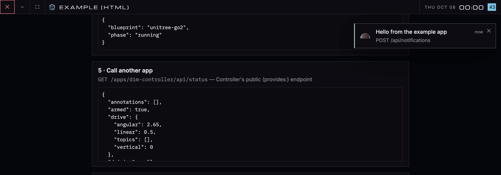
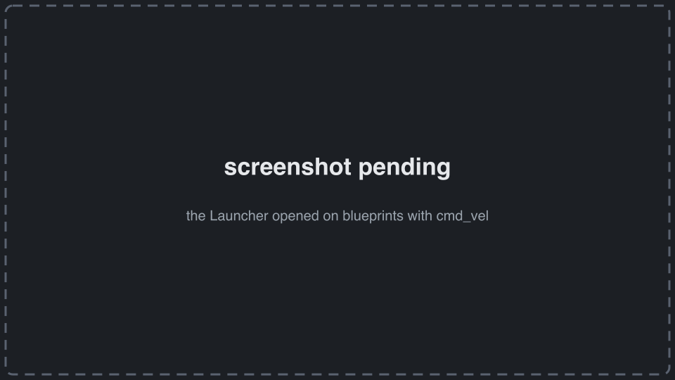

# dim-example-html

```sh
dimos-desktop install github.com/jeff-hykin/dim-example-html
```

(or Desktop → App Store → **Install From URL** → `github.com/jeff-hykin/dim-example-html`)

[](https://github.com/jeff-hykin/dim-example-html/generate)

A [dimOS Desktop](https://github.com/jeff-hykin/dimos-desktop-mirror) app in one file, `frontend/index.html`: no build,
no server. Its whole UI is [dimos-react](https://github.com/jeff-hykin/dimos-react) (Desktop's theme followed live,
cards, buttons, inputs, video, toasts); its data comes through [dim-app](https://github.com/jeff-hykin/dim-app)'s
`DimApp`. Every snippet below is from that file, trimmed to the point. How apps work:
**[Making a dimOS app](https://github.com/jeff-hykin/dimos-desktop-mirror/blob/main/docs/create-apps/index.md)**.
Other examples: [Deno + React](https://github.com/jeff-hykin/dim-example-deno) ·
[Rust](https://github.com/jeff-hykin/dim-example-rust) · [Bun](https://github.com/jeff-hykin/dim-example-bun).



## Connect

No build: the libraries load from esm.sh by URL (pinned tags), and an import map shares one React between the page and
dimos-react.

```html
<script type="importmap">
    {
        "imports": {
            "react": "https://esm.sh/react@19.2.0",
            "react/": "https://esm.sh/react@19.2.0/",
            "react-dom": "https://esm.sh/react-dom@19.2.0",
            "react-dom/": "https://esm.sh/react-dom@19.2.0/",
            "dimos-react": "https://esm.sh/gh/jeff-hykin/dimos-react@v0.2.0-beta1/src/index.ts?external=react,react-dom,three"
        }
    }
</script>
```

`DimApp` holds the page's zenoh-gateway connection (dimos-react's hooks share it) and loads dimos's message codec
(`/dimos/msgs.js`, generated from the dimos that's running).

```js
import { createRoot } from "react-dom/client"
import { createElement as h } from "react"
import { AppProvider, Button, Card, Stat } from "dimos-react"
import { DimApp } from "https://esm.sh/gh/jeff-hykin/dim-app@v0.20.4/source/dim_app.js"

const app = new DimApp({
    msgDecodeEndpoint: "../../dimos/msgs.js",
    // a heartbeat lets the gateway publish our deadman (a zero Twist) if this page dies mid-drive
    connectOptions: { heartbeatHz: 5, heartbeatMisses: 3 },
})

// AppProvider: Desktop's skin (followed live), toasts, dialogs, URL state
createRoot(document.getElementById("root")).render(h(AppProvider, null, h(App)))
```

## Subscribe to a topic, decoded

`/odom` arrives as a plain `geometry_msgs.PoseStamped` object.

```js
useEffect(() => {
    const options = { type: "geometry_msgs.PoseStamped", delivery: "latest", maxHz: 20 }
    return app.subscribe(topic, ({ pose }) => {
        const { x, y, z, w } = pose.orientation
        const yaw = Math.atan2(2 * (w * z + x * y), 1 - 2 * (y * y + z * z))
        setPose({ x: pose.position.x, y: pose.position.y, yaw: yaw * 180 / Math.PI })
    }, options)
}, [topic])

h(Stat, { label: "x", value: pose ? pose.x.toFixed(2) : "—" })
```

## A camera, and a snapshot of it

The gateway turns a `sensor_msgs.Image` topic into an H.264 track; dimos-react's `MediaFrame` plays it and
`captureFrame` grabs the frame showing.

```js
useEffect(() => {
    const options = { delivery: "latest", maxHz: 30, encoding: "dimos_lcm_image" }
    return app.zenoh.subscribe(`dimos/${topic}/sensor_msgs.Image`, options, ({ mediaStream }) => {
        if (mediaStream) {
            setStream(mediaStream)
        }
    })
}, [topic])

h(MediaFrame, { stream, ref: video, placeholder: `waiting for /${topic}` })
h(Button, { icon: "camera", onClick: () => setStill(captureFrame(video.current)) }, "Snapshot")
still && h(MediaFrame, { src: still, alt: "the last snapshot" })
```

## Drive: publish `cmd_vel` with a deadman

Nothing goes out until a button is pressed. While driving, a zero Twist is armed on the gateway as the deadman (sent if
the page dies); the release sends it and disarms.

```js
const twist = (forward, turn) => ({ linear: { x: forward }, angular: { z: turn } }) // fields left out are zero

publisher = await app.publisher(topic, "geometry_msgs.Twist", { delivery: "latest" })
await publisher.setDeadman(twist(0, 0))

h(Button, {
    icon: "arrow-up",
    onPointerDown: () => (driving = setInterval(() => publisher.put(twist(0.3, 0)), 100)), // 10 Hz while held
    onPointerUp: () => {
        clearInterval(driving)
        publisher.stop() // the zero Twist, then silence
    },
}, "forward")
```

## Ask dimos what's running

```js
const { launch } = await json("../../dimos/runs")
// { blueprint: "unitree-go2-basic", phase: "running" }, or null
```

## Call another app

Another app's public endpoint (its `provides:`), at `../../apps/<name>/`.

```js
await json("../../apps/dim-controller/api/status")
```

## Call a skill

List the running blueprint's skills into a `Select`; call one only on a click (a skill can move the robot).

```js
const { skills } = await json("../../dimos/skills") // [{ name, module, description, params (JSON Schema) }]

h(Select, { value: chosen, onChange: setChosen, options: skills.map(({ name, module }) => [name, `${module}.${name}`]) })
h(Button, {
    variant: "primary",
    onClick: () => postJson("../../dimos/skills/call", { skill: skill.name, module: skill.module, args: JSON.parse(args) }),
}, "Call") // { ok, text, via, ... }
```

## A Desktop notification

```js
json("../../api/notifications", {
    method: "POST",
    headers: { "content-type": "application/json" },
    body: JSON.stringify({ title: "Hello from the example app", body: "POST /api/notifications", kind: "ok" }),
})
```



## Open the Launcher, filtered

```js
import { openApp } from "https://esm.sh/gh/jeff-hykin/dim-app@v0.20.4/source/desktop.js"

openApp("launcher", { stream: "cmd_vel" }) // only blueprints that drive a robot; also query, robot, selected
```



## Look like Desktop in every skin

Nothing to write: `AppProvider` (dimos-react's `DimThemeProvider`) links Desktop's `/theme.css`, applies the skin and
corners the person picked, and follows a change live; every dimos-react component is styled only with Desktop's tokens.

## Declare what it calls: `dimos.yaml`

Desktop refuses (403 + a notification) any call not listed here. Spec v1.2 adds `zenoh:`: what the page may
subscribe to and publish through the zenoh-gateway, in the shape of zenoh's ACL rules; without it a v1.2 page gets no
zenoh at all.

```yaml
title: Example (HTML)
spec-version: v1.2
uses:
    "@dimos-gateway":
        - GET /runs
        - GET /msgs.js
        - GET /skills
        - POST /skills/call
    "@desktop-gateway":
        - POST /api/notifications
    "@zenoh-gateway": ">=0.5 <0.6"
    dim-controller:
        - GET api/status
# spec v1.2: what the page may do on zenoh, as zenoh's ACL config (the topic boxes take any topic of these types)
zenoh:
    default_permission: deny
    read:
        - id: odom-and-camera
          messages: [declare_subscriber, put] # subscribe, and receive its samples
          key_exprs: ["dimos/**/geometry_msgs.PoseStamped", "dimos/**/sensor_msgs.Image"]
          permission: allow
    write:
        - id: drive
          messages: [put] # the cmd_vel publisher (and its deadman)
          key_exprs: ["dimos/**/geometry_msgs.Twist"]
          permission: allow
```

Check it: `dimos-desktop app check .`

## Files

- `frontend/index.html`: the whole app. With no `flake.nix`, Desktop serves only `frontend/`, as is, at `/apps/<name>/`
- `dimos.yaml`: the contract with Desktop
- `icon.svg`: its icon in the dock and App Store
